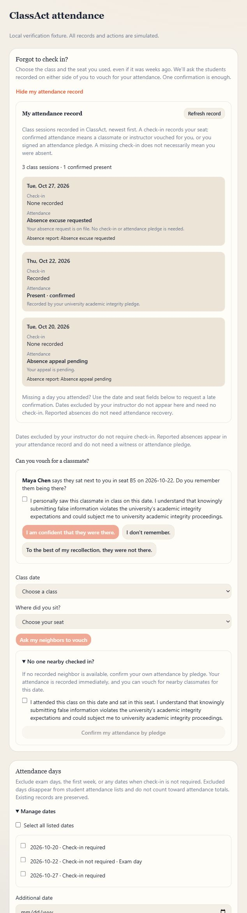

# Attendance recovery verification — October 29, 2026

## Result

Local implementation is ready for deployment review. Production was not changed.

- Full Vitest suite: **892 passed across 81 files**.
- TypeScript: passed.
- Production build: passed with network access for the app's existing Google Fonts. The first restricted-network attempt failed only on font downloads.
- ESLint: zero errors; one warning in the unrelated existing `scripts/test-contribution-touch.mjs`.
- `git diff --check`: passed.
- Isolated PostgreSQL/PGlite attendance recovery tests: passed.
- Existing Student View migration/RLS/attendance/isolation tests: passed.
- External correctness and security reviews: final passes reported no remaining actionable defects. The security reviewer also ran the isolated attendance recovery script. These were explicitly authorized by the user; neither review tested production.
- Browser: actual components with fictional records and simulated server actions, desktop and 390-pixel mobile. Verified failed neighbor request, checkbox-gated self pledge, checkbox-gated witness confirmation, bulk exclusion success, pending absence/appeal states, and no horizontal overflow with expanded forms.

## Review corrections

Aligned attendance numerator/denominator for historical check-in plus absence combinations; excluded waived dates from future automated absence assessment priors; blocked check-in identity changes that could bypass date restrictions; serialized session creation with policy changes without reversing lock order on session updates; reloaded the authoritative decision if a concurrent instructor ruling or reassessment superseded a pending assessment; provided both instructor decisions for a pending report; aligned no-schedule date lookup with course timezone.

## Release boundary

Apply `0055_attendance_recovery.sql` before deploying the application. No real student records, emails, or live academic decisions were created for verification. Authenticated end-to-end testing against the migrated deployment remains outstanding. Existing unrelated working-tree edits were preserved.

The fixture screenshot below is illustrative verification, not evidence of a production deployment.

